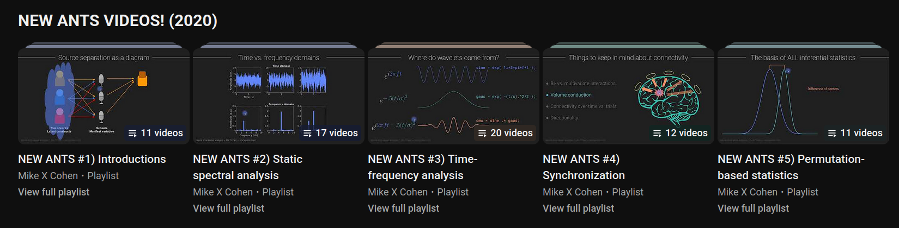

# Good Programming Practices 💻

In academic settings, people tend to write code with function in mind: they have a scientific goal to achieve and the time spent coding must lead to that goal only. This strategy can be rewarding once results start coming in, but rewards can be even larger by considering _structure_ and _style_. Code written with no attention to structure or style can be slow to run and difficult to read, with negative effects on its efficiency and reusability. This means that a preprocessing pipeline can run in days instead of hours, or that code written today will not be understood tomorrow &mdash; by colleagues, students, readers of our papers, or our future selves. 

Code efficiency is a complex topic that requires technical knowledge and programming practice. Conversely, readability and reusability are relatively easy to achieve &mdash; but impactful nonetheless. This document will focus on practices that can improve the readibility and reusability of scientific code, identifying them with the collective label of _good programming practices_ (GPPs). GPPs vary between languages and communities: Matlab GPPs can be different from Python GPPs, and neuroscience coders might follow different conventions than engineering coders. However, some practices that impact readability and usability are equally valid across languages and domains. Those practices are _scripting_, _modularity_, _parametrization_, _documentation_, and _using environments or containers_. 

## 1. Scripting 
This hands-on activity was based entirely on Jupyter Notebooks, which are great when you need to present code, text and multimedia in a single document. This usually happens in contexts like teaching or step-by-step demonstrations, which require some form of interactive use: the user sits in front of the computer, is interested in attending operations as they happen, and is continuously required to provide inputs (for example, running a notebook cell-by-cell). This is not the case for many real-world scenarios, like the preprocessing of data from an entire neuroimaging experiment. In those cases, users might prefer scripts.

Scripts are simple text files that contain code, with no other addition &mdash; that is, no well-formatted text explanations nor rich media. Python scripts have a `.py` extension and can be read or modified with a variety of tools: advanced code editors like [VSCode](https://code.visualstudio.com/), [PyCharm](https://www.jetbrains.com/pycharm/) or [Spyder](https://www.spyder-ide.org/), but also simple notepads or the terminal. This repository contains a folder called [`scripts`](/scripts), where you can find `.py` files that reproduce the operations carried out by [`pipeline.ipynb`](/pipeline.ipynb).

Compared to notebooks, scripts are more lightweight, they do not depend on continuous user input, and they lend themselves to modularity (see below).

## 2. Modularity
Often, we write our code in a single file that carries out all the operations that we need. In the case of TMS-EEG preprocessing, that would be a single script that does everything from reading the data to calculating statistics on the TEP. The file [`scripts/bad_example.py`](https://github.com/matteo-d-m/brainstim-multimodal/blob/main/scripts/bad_example.py) is one such example &mdash; and a bad one: while it can lead to scientifically valid results, the single-script approach has negative effects on the readability, reusability, and adaptability of the code. The reason is that understanding the operations implemented by some code becomes increasingly difficult as the code's length increases, as does locating the parts that might need improvements or corrections. This is especially true for complex scripts, where code of actual scientific value can mix with code that implements simple housekeeping tasks, like reading and writing data, changing filenames, reshaping arrays, and similarly mundane (albeit important) things. 

The alternative to giant scripts is _modularity_: a strategy that consists of breaking code into independent sections that can live in different files and be reused in different contexts. For example, so-called _toolboxes_ like [MNE-Python](https://mne.tools/stable/index.html) are collections of code units that carry out single tasks, live in separate files and can be reused indefinitely. When users call MNE-Python functions, they are actually reusing previously written code that was designed with modularity in mind. 

In the context of a TMS-EEG pipeline, modularity can be implemented by distributing the code over three different files: one with reusable [functions](https://realpython.com/defining-your-own-python-function/) (or _utilities_) that implement single preprocessing steps ([`scripts/utils.py`](https://github.com/matteo-d-m/brainstim-multimodal/blob/main/scripts/utils.py)), one with modifiable parameters that regulate the behaviour of such functions ([`scripts/config.py`](https://github.com/matteo-d-m/brainstim-multimodal/blob/main/scripts/config.py)), and one (the _master script_) that calls all functions in the right order, feeding them the right parameters ([`scripts/pipeline.py`](https://github.com/matteo-d-m/brainstim-multimodal/blob/main/scripts/pipeline.py)). With this approach,readers should be able to: 

- Get a sense of the whole pipeline by reading the master script (`pipeline.py`)
- Inspect the specifics of a single step in the utilities file (`utils.py`)
- Easily find and modify a parameter in the configuration file (`config.py`)

The idea of a single file that stores all configurable parameters introduces the concept of _parametrization_.

## 3. Parametrization
Parametrization is the practice of defining free-to-vary parameters instead of hard-coding quantities into a section of code. 

Imagine you have the following list. The numbers in it could mean anything &mdash; for example, they could be timepoints of interest for EEG data analysis:

```python
timepoints = [0,1,2,3,4,5,6,7,8,9]
```

Imagine you want to extract the elements in fourth, fifth, and sixth position (that is, the items located at indices 3, 4 and 5, as Python counts from 0).
The following code does the job:

```python
timepoints_of_interest = timepoints[3:5]
```

Now imagine two different scenarios:

- In one scenario you are coding a long and complex data analysis pipeline, where the extraction described above is repeated a number of times along the pipeline. The timepoints in fourth, fifth and sixth position represent the times when the subject is seeing stimulus A, but there are other times of potential interest when the subject looks at stimulus B. After discussing with your colleagues, you decide to shift your focus from analysing the response to stimulus A to analysing the response to stimulus B, which occurs later. Because the extraction recurs along the pipeline, you need to change all occurrences of the code above, at risk of forgetting some occurrences and getting odd results in return
- In another scenario you want to reproduce the analyses carried out by the authors of a paper or by a former member of your research  group. You go through their code, find the lines that extract the timepoints of interest and have no idea what numbers like 3 and 5 represent from a scientific point of view: is it the response to stimulus A, the response to stimulus B, or is it something else entirely? 

Both scenarios are extremely common in everyday scientific work. As trivial as they may seem, they can cause very long delays &mdash; especially to beginners, who have no experience to help them understand the cause of errors or find meaning in the code. However, both scenarios can be easily avoided by parametrizing the objects of interest &mdash; that is, assigning them to variables with an informative name, which are defined just once and can be changed forever with a single edit, without having to scroll in search of all occurrences: 

```python
STIMULUS_ONSET, STIMULUS_OFFSET = 3, 5									# changing this

timepoints_of_interest = timepoints[STIMULUS_ONSET:STIMULUS_OFFSET]     # changes that
```

Parameters can be anything from simple indices (as in the example) to the cut frequency of a filter or a statistical significance threshold: they are any quantity that is free to vary and is instrumental to one or more data analysis steps. Ideally, all parameters should be defined in a dedicated file like [`/scripts/config.py`](https://github.com/matteo-d-m/brainstim-multimodal/blob/main/scripts/config.py). This should ensure clarity and ease of retrieval, for ourselves as well as future users.  

## 4. Documentation
Reading code written by others is a frequent task for anyone in a research setting, where you can find yourself reading code from colleagues or from the developers of some toolbox. In both cases, the task can be difficult and time-consuming &mdash; especially if the code is not well-documented.

Documentation is text that explains what code does. Roughly speaking, there exists two levels of documentation, which we might call _in-code documentation_ and _out-of-code documentation_.

### 4.1. In-Code Documentation
In-code documentation is a set of conventions that make code understandable without resorting to any external resource. In-code documentation consists of variable names and docstrings. For example, the following Python function has in-code documentation because all names are self-explanatory and there is a docstring (that is, the text in quotes) to explain how the function works:

```python
def add_and_multiply(number1, number2, coefficient):
	"""This function adds two numbers and multiplies them for a coefficient.
	
	Parameters:
	number1 -- the first number to add (type: float)
	number2 -- the second number to add (type: float)
	coefficient -- the coefficient (type: float)
	
	Returns:
	result -- the result of the operation (type: float)
	"""
	
	result = (number1 + number2) * coefficient
	return result
```

Compare this to the following function, which does the same job but without a docstring nor clear variable names:

```python
def addmult(m,n,c):
	y = (m+n)*c
	return y
```

Less clear, right? And even less so if the function serves more complex tasks, like interpolating a TMS pulse in continuous data. The following function is a non-documented example:

```python
from scipy.interpolate import CubicSpline

def tms_interp(eeg, events, pre, post):
	eeg = eeg.copy().get_data().astype("float32")
	chans = eeg.shape[0]
	times = np.arange(eeg.shape[1])
	pre = pre*5000
	post = post*5000

	for n, ev in enumerate(events):
		t = int(event[0])
		interpMin = t - pre
		interpMax = t + post
		mask = np.ones(eeg.shape[1], bool)
		mask[interpMin:interpMax] = False
		idx = t[mask]
		for ch in range(chans):
			data = eeg[channel, mask]
			cs = CubicSpline(idx, data)
			new_indices = np.arange(interpMin,interpMax)
			interp = cs(new_indices)
			eeg[channel, interpMin:interpMax] = interp 

	eeg_interp = mne.io.RawArray(eeg,eeg_data.info)
	return eeg_interp
```

while this is the same function with in-code documentation:

```python
from scipy.interpolate import CubicSpline

def interpolate_pulse_cubic_spline(eeg_data, events_array, interpolate_from, interpolate_to):
	"""Interpolates TMS pulse artifacts with a cubic spline, channel-by-channel. 

	Parameters:
	eeg_data -- continuous EEG data with artifacts to interpolate (type: mne.Raw object)
	events_array -- an array of events. Event times are in column 0 (type: NumPy array)
	interpolate_from -- the start time of the interpolation window, in seconds (type: float)
	interpolate_to -- the end time of the interpolation window, in seconds (type: float)

	Returns:
	post_interpolation_eeg_data -- continuous EEG data with no more artefacts (type: mne.Raw object)
	"""
	
	raw_eeg_time_series = eeg_data.copy().get_data().astype("float32")
	number_of_channels = raw_eeg_time_series.shape[0]
	all_time_points = np.arange(raw_eeg_time_series.shape[1])
	pre_pulse_points = interpolate_from*eeg_data.info["sfreq"]
    post_pulse_points = interpolate_to*eeg_data.info["sfreq"]

	for event_number, event in enumerate(events_array):
		print(f"Processing event {event_number}...")
		event_time = int(event[0])
		artifact_window_min = event_time - pre_pulse_points
		artifact_window_max = event_time + post_pulse_points
		artifact_mask = np.ones(shape=raw_eeg_time_series.shape[1], 
								dtype=bool)
		artifact_mask[artifact_window_min:artifact_window_max] = False
		relevant_time_points = all_time_points[artifact_mask]
		for channel in range(number_of_channels):
			print(f"Working on channel {channel}...")
			data_of_interest = raw_eeg_time_series[channel, artifact_mask]
			cubic_spline = CubicSpline(x=relevant_time_points,
									   y=data_of_interest)
			new_indices = np.arange(start=artifact_window_min,
									stop=artifact_window_max)
			interpolated_pulse = cubic_spline(new_indices)
			raw_eeg_time_series[channel, artifact_window_min:artifact_window_max] = interpolated_pulse 

	post_interpolation_eeg_data = mne.io.RawArray(data=raw_eeg_time_series,
												  info=eeg_data.info)
	return post_interpolation_eeg_data
```
### 4.2. Out-of-Code Documentation
Out-of-code documentation is any information that is useful to understand and use some code, but does not fit inside the code itself. This can be a text guide for how to use the code (typically, a file called README like [this one](https://github.com/matteo-d-m/python-course-cimec-2023/blob/main/README.md)), a website with long-form explanations about a toolbox (for example, [this one](https://mne.tools/stable/index.html)), or a set of instructions on how to make the necessary installations (for example, what you got [here](https://github.com/coneco-lab/brainstim-multimodal?tab=readme-ov-file#installation-instructions)). This last step is particularly important, as any software depends on a set of other software to function correctly, and users who have no information about it are bound to waste their time.

### 4.3. Documentation Checklist
In practice, one can see documentation as the process of going through the following checklist:

- Use informative variable names
- Write docstrings for your functions
- Use READMEs for project repositories
- Give detailed information on dependencies and installation instructions 

## 5. Using Environments or Containers
The following cases occur frequently in settings where people write and share their code, including research groups where multiple people use the same analysis pipeline:

- **Case 1.** You receive code from a colleague. This code relies on a set of _dependencies_ &mdash; that is, software tools that the code is built upon. You try running the code, but you fail because you do not have the dependencies. After a long search that involves a lot of trial-and-error, you figure out the dependencies and install them, but find out that they have further dependencies which you cannot easily retrieve
- **Case 2.** You receive code from a colleague. This code relies on a certain version of a given library, but you have another version. This causes errors in the code or yields suboptimal results because the two library versions differ   
- **Case 3.** You receive code from a colleague. Everything works smoothly, but you get unxpected results due to performance differences between your computing set-up and your colleague's

All three cases are undesirable and can be avoided using environments or containers. 

### 5.1. Anaconda environments
Taking part in the hands-on activity required you to install and use Anaconda. Anaconda is a package and environment manager &mdash; that is, software that orchestrates the interactions between other softwares, allowing users to run multiple computational projects on the same machine without creating conflicts between them. 

When you install Anaconda, you get:

- The Python programming language
- Easy and automated access to a huge variety of Python-based software
- A tool to easily create, manage, and share _environments_

The latter is perhaps Anaconda's most interesting feature. Environments are _"self-contained, isolated spaces where you can install specific versions of software, including dependencies, libraries, and Python versions. This isolation helps avoid conflicts between package versions and ensures that your projects have the exact libraries and tools they need"_ (source: Anaconda documentation &mdash; accessed December 2025). In other words, Anaconda allows researchers to partition their computer into isolated virtual compartments, making sure that each project has all the necessary software and avoiding any conflicts. 

Importantly, the instructions to create environments can be easily saved and shared as text files that are commonly referred to as _environment files_. This was the role of [`brainstim-multimodal.yml`](https://github.com/matteo-d-m/brainstim-multimodal/blob/main/brainstim-multimodal.yml): specify all the software that we needed for the hands-on activity in all the appropriate version, so that you could recreate the exact same computing environment that I use with the one-line command `conda env create -f brainstim-multimodal.yml`.

The [Anaconda documentation](https://www.anaconda.com/docs/main) contains detailed concept guides and step-by-step tutorials. You can go through them to start understanding Anaconda: you will soon find out that acquiring a working knowledge is easier and faster than one might think.  

### 5.2. venv & pip
An alternative to Anaconda is [`venv`](https://docs.python.org/3/library/venv.html), which ships directly with a [basic Python installation](https://www.python.org/downloads/). Using `venv` you can create an environment, and using the [`pip`](https://pip.pypa.io/en/stable/) package manager you can install Python packages inside it. As with Anaconda, the resulting software environments can be saved and shared through text files &mdash; which, for the `venv`-`pip` combination, are usually titled `requirements.txt` and can be installed as `pip install -r requirements.txt`.

At a superficial exam, the `venv`-`pip` combination looks the same as Anaconda. However, the two products have several important differences that are well described by [this](https://www.anaconda.com/blog/understanding-conda-and-pip) document on the Anaconda website. In summary, Anaconda has three features that make it more versatile: 

- It is both an environment and a package manager, so you get two services from a single software. In contrast, `venv` is only an environment manager and `pip` is only a package manager, so you need to install them both if you want full service
- Anaconda is mainly focused on Python, but it also includes the R, Julia, and Scala programming languages and a vast array of R packages. In contrast, `venv` environments are specific to Python projects and `pip` has only access to Python packages that are stored on the [Python Package Index (PyPI)](https://pypi.org/)
- [According to Anaconda developers](https://www.anaconda.com/blog/understanding-conda-and-pip), Anaconda does a better job at ensuring that all installed packages have all their dependencies in order

### 5.3. Containers 
Environments created with Anaconda or `venv` are great to package the most direct dependencies of a software project, but cannot package an entire computing environment. In practice, this means that they can package your code's most immediate dependencies and make it easy to share them, but they cannot isolate your code from the surrounding computer. Therefore, your code can still be exposed to reproducibility failures related to system-wide differences between computers, that an Anaconda or `venv` environment cannot control. In these cases, it helps to use containers. 

In the definition of [Moreau et al. (2023)](https://doi.org/10.1038/s43586-023-00236-9), a container is _"a self-contained and executable package that includes all of the necessary components for running a software application, such as system tools, libraries settings and the application itself, as well as any operating system components that are not provided by the host operating system. This means that containers are completely isolated from one another and the host operating system, and they can run anywhere, regardless of the environment"_. In other words, using a container minimizes the probability of encountering reproducibility failures due to differences between computers that extend beyond your analysis code and its most immediate dependencies, thereby avoiding situations where some code runs smoothly on Windows 10 but not on Windows 11, on Linux but not on MacOS, etc. Minor differences might still persist because containers cannot fully modify the way your code exploits hardware resources, but those differences should be negligible.

# Interesting Links 🔗 🌍
This document contains a commented list of links to internet resources that may be of interest to Brain Stimulation & Multimodal Electrophysiological Recording students. Those resources are not necessarily part of the course bibliography and are meant to nurture the students' personal interest beyond the exam.

The hands-on activity has treated TMS-EEG preprocessing using relatively advanced computational tools like modern Python libraries and Anaconda environments. In doing so, it has touched upon the topic of reproducibility and used several data analysis tools. Therefore, links are categorised accordingly. 

## 1. EEG & TMS-EEG Analysis
### 1.1. Papers on Methodological Issues in (TMS-)EEG Data Analysis
- [Bertazzoli et al. (2021)](https://doi.org/10.1016/j.neuroimage.2021.118272) show that using different preprocessing pipelines on the same TMS-EEG dataset yields significantly different results. [Botvinik-Nezer et al. (2020)](https://doi.org/10.1038/s41586-020-2314-9) had obtained similar results using fMRI data
- Results like the previous have nurtured the debate on the reproducibility of (TMS-)EEG data analysis and emphasised the urgency to define preprocessing standards. In this respect, the following articles may be of particular interest:
    - [Brancaccio et al. (2024)](https://doi.org/10.1016/j.neuroimage.2024.120874) extend on Bertazzoli et al.'s approach by comparing different pipelines on simulated data with a known ground-truth &mdash; thereby estimating not only the variability between pipelines, but also the ability of each pipeline to retrieve the ground truth (something that is usually not available in neuroimaging studies)
    - [Rogasch et al. (2022)](https://doi.org/10.1016/j.jneumeth.2022.109494) discuss the challenges of TMS-EEG preprocessing and try to formulate a set of best practices. Interestingly, one of their suggestions is to use two or three different pipelines and take the between-pipelines variability when interpreting results 
    - [Hernandez-Pavon et al. (2023)](https://doi.org/10.1016/j.brs.2023.02.009) take it one step further, providing a more thorough discussion of all the most relevant TMS-EEG methodological issues (including those pertaining to data collection)
    - [Trübutschek (2024)](https://doi.org/10.1162/jocn_a_02087) introduce the EEGManyPipelines initiative, which involves hundreds of researchers across the globe analysing the same EEG dataset with their preferred strategies. This is expected to provide a thorough account of variability in preprocessing practices across the globe and a robust estimate of its impact on scientific conclusions
- [Delorme (2023)](https://doi.org/10.1038/s41598-023-27528-0) compared a set of pipelines on the same EEG dataset. His results show that sophisticated preprocessing strategies do not increase the percentage of channels showing statistically significant evoked potentials compared to applying high-pass filtering and bad channels interpolation only. This suggests that preprocessing might hide differences between conditions by inadvertently removing signal together with the noise
    - [de Cheveigné (2023)](https://doi.org/10.1101/2023.06.19.545602) does not agree with Delorme, questioning the conclusion that "EEG is better left alone" and recommending case-by-case critical thinking
- [Pion-Tonachini et al. (2019)](https://doi.org/10.1016/j.neuroimage.2019.05.026) present an automatic classifier of independent components, with the aim of reducing between-raters variability. This work is particularly valuable because of its broad scope, which includes code (accessible through MNE-Python functions), labelled data, and a [supporting website](https://labeling.ucsd.edu/tutorial). This last resource can be particularly useful for students. because it contains [written directions on how to label components](https://labeling.ucsd.edu/tutorial/labels) and a [service to practice labelling](https://labeling.ucsd.edu/tutorial/practice), with a chance to see what others do

### 1.2. Papers on Methodological Issues in TMS-EEG Data Collection
The hands-on activity has focused on data preprocessing. However, data collection is just as critical in the construction of new scientific knowledge, for at least two reasons:

- The first reason is that preprocessing cannot make miracles, and particularly dirty data will require extensive cleaning that might introduce unwanted variability. Therefore, it is important to collect clean data that will require minimum preprocessing
- The second reason is that some aspects of data collection might look like technical details, but they actually have a strong impact on the _content_ of the data &mdash; and consequently, on the scientific conclusions that might be drawn from them. In this respect, the following papers might be of special interest:
    - [Guidali et al. (2023)](https://doi.org/10.1111/ejn.16127) demonstrate that stimulation parameters like current direction and pulse waveform impact the amplitude, latency and replicability of TEPs 
    - [Lucarelli et al. (2025)](https://doi.org/10.1007/s10548-025-01113-2) find that variations of current direction and pulse waveform might actually activate different cortical pathways
    - [Stango et al. (2025)](https://doi.org/10.1016/j.neuroimage.2025.121526) show that TMS pulse intensity and EEG sampling rate affect the shape of two typical TMS-EEG artifacts (the pulse and decay artifacts) 

Overall, articles like these show that data collection is not a one-size-fits-all process: the way we use the instruments matters.

## 2. Python, Anaconda, and Productivity Tools
### 2.1. Python
This hands-on activity was built around Python: a modern, open-source, free and highly readable programming language that is currently on the rise in the neuroscientific community and beyond. There are many reasons behind this choice, all detailed in a dedicated document ([Why Python?](./why-python.md)). Unfortunately, cognitive neuroscience students are usually not taught any Python, which is the reason why you were not asked to produce original code yourself during your hands-on activity. If you want to learn more about this language, you can attend the course [Introduction to Computer Programming (Python)](https://unitn.coursecatalogue.cineca.it/insegnamenti/2025/50802_649472_95796/2025/50802/10876?annoOrdinamento=2025&coorte=2025), taught by prof. Paolo Rota in the CLC track at CIMeC's master. Otherwise, the following links might serve as a reference for a less structured, lower-commitment learning path:

- [Python for (open) Neuroscience](https://github.com/vigji/python-cimec-2024), a course taught by Luigi Petrucco at CIMeC's doctoral school in spring 2024. There is also a more recent version of this course (2025) but it is less complete, so I would suggest you stick to the 2024 edition
- [Python for Neuroscience](https://pyforneuro.com/) is a website with a good collection of basic Python tutorials and a set of neuroscience use cases
- [Real Python](https://realpython.com/) is a great resource for delving deeper into specific topics, like [classes](https://realpython.com/python-classes/)

### 2.2. Anaconda
Anaconda is a key component of many Python-based workflows. There was not enough time to introduce it thoroughly during the hands-on activity, but there is not much more to it than what you experienced in class. 

Anaconda is a package manager &mdash; that is, software that orchestrates the interactions between other software. Its power lies in three features:

- Easy access to a wide variety of Python and R libraries
- Ability to easily create, manage, and share environments &mdash; that is, _"self-contained, isolated spaces where you can install specific versions of software , including dependencies, libraries, and Python versions. This isolation helps avoid conflicts between package versions and ensures that your projects have the exact libraries and tools they need"_ (source: Anaconda documentation &mdash; accessed December 2025) 
- Ability to export and share environments easily

The [Anaconda documentation](https://www.anaconda.com/docs/main) contains everything there is to know about it, including concept guides and step-by-step tutorials.

### 2.3. Productivity Tools
During the hands-on activity we used Jupyter Notebooks from their web-based interface. That was a quick-and-dirty solution to let you use the notebooks without introducing even more new tools. However, there are better ways to use notebooks and, in general, to code.

The best way to interact with notebooks and scripts is to use a modern code editor like [VSCode](https://code.visualstudio.com/), [PyCharm](https://www.jetbrains.com/pycharm/), or [Spyder](https://www.spyder-ide.org/). These are user-friendly interfaces between users and programming languages that can greatly facilitate data analysis workflows. I personally use VSCode and I think it is a great tool &mdash; especially because it has an integrated file manager, a terminal, and a [Git](https://github.com/coneco-lab/git-tutorial) interface that are easy to find and use. 

## 3. Reproducibility & Open Science Practices
Over the last 20 years, reproducibility has become a hot topic in neuroscience and beyond &mdash; sparking interest for topics like _open science_, _open data_, and _open code_. This interest stemmed from a series of impactful papers that documented the low reproducibility of scientific results &mdash; a phenomenon that mostly plagues "soft" experimental sciences like the biomedical and social sciences (thereby including neuroscience). \
The list below provides pointers to the main papers of interest and to a few websites that might help you navigate the _open_ world. 

### 3.1. Essential Papers on the Reproducibility Crisis
- [Ioannidis (2005)](https://doi.org/10.1371/journal.pmed.0020124) opened the debate on the reproducibility of scientific results with this quantitatively-informed essay, whose provocative title says it all: _Why Most Published Research Findings Are False_. The author makes a critical analysis of the current version of the scientific method and concludes that _"a research finding is less likely to be true when the studies conducted in a field are smaller; when effect sizes are smaller; when there is a greater number and lesser preselection of tested relationships; where there is greater flexibility in designs, definitions, outcomes, and analytical modes; when there is greater financial and other interest and prejudice; and when more teams are involved in a scientific field in chase of statistical significance"_
- [Vul et al. (2009)](https://doi.org/10.1111/j.1745-6924.2009.01125.x) argue that social and affective neuroscience are plagued by bad statistical practices that artificially increase correlations between fMRI metrics and behavioural scores, thereby increasing the false positive rate to unacceptable values
- Following papers like the previous, a wealth of studies have investigated the true size and latent causes of reproducibility failures in neuroscience and psychology. In this respect, the following papers are essential reads: [Simmons et al., 2011](https://doi.org/10.1177/0956797611417632), [Button et al., 2013](https://doi.org/10.1038/nrn3475), [Open Science Collaboration, 2015](https://doi.org/10.1126/science.aac4716), [Szucs & Ioannidis (2017)](https://doi.org/10.1371/journal.pbio.2000797), [Munafò et al., (2017)](https://doi.org/10.1038/s41562-016-0021)

### 3.2. Glossaries, Open Books & Guides
The following internet resources might be useful to navigate the _open_ world and gain insights that might guide your future work:
- [Crüwell et al. (2019)](https://doi.org/10.1027/2151-2604/a000387) provide an annotated list of introductory open science readings 
- [Kathawalla et al. (2021)](https://doi.org/10.1525/collabra.18684) provide a tutorial guide to core open science practices, aimed specifically at graduate students 
- [The Framework for Open and Reproducible Research Training (FORRT)](https://forrt.org/) curates a detailed [glossary of open science terms](https://doi.org/10.1038/s41562-021-01269-4), which becomes much needed once you start delving deeper into open science
- [Experimentology](https://doi.org/10.25936/3JP6-5M50) is a free book on experimental psychology methods, with an eye on open and reproducible practices
- [Better Code, Better Science](https://bettercodebetterscience.github.io/book/) is a free book on good programming practices by Russel Poldrack, a prominent exponent of the open science movement. The book encourages AI-assisted coding, but the principles it treats remain valid in the absence of AI use  

### 3.3. The Italian Reproducibility Network 
[The Italian Reproducibility Network (ITRN)](https://www.itrn.org/) is an association of Italian scientists that promote the use of open science practices through research and education.

## 4. Data Analysis Resources
The following links point to learning resources for EEG data analysis and some prerequisite mathematics or coding skills. Some are more formal than others but they are all high-quality.

- Former neuroscience professor Mike X Cohen has an excellent [YouTube channel](https://www.youtube.com/@mikexcohen1/featured) where he uploads tutorials and short courses on EEG data analysis, mathematics, and data science. The NEW ANTS series is particularly useful as an introduction to EEG data and their analysis. Cohen is also the author of an excellent textbook, _Analyzing Neural Time Series Data_ (MIT Press), that largely overlaps with the ANTS video series
  
- If you are willing to understand EEG data analysis in detail, you will need a working understanding of linear algebra concepts. If you cannot afford a full-semester course, the series of video lectures [Essence of linear algebra](https://www.youtube.com/playlist?list=PLZHQObOWTQDPD3MizzM2xVFitgF8hE_ab) by Grant Sanderson (also known as [3Blue1Brown](https://www.3blue1brown.com/)) can be a very good start
- If you are particularly interested in the mechanics of time frequency analysis, you might enjoy [Seeing Circles, Sines, and Signals](https://jackschaedler.github.io/circles-sines-signals/) by Jack Schaedler. The examples are centered on sound waves, but the mathematics apply equally to electrophysiological waves