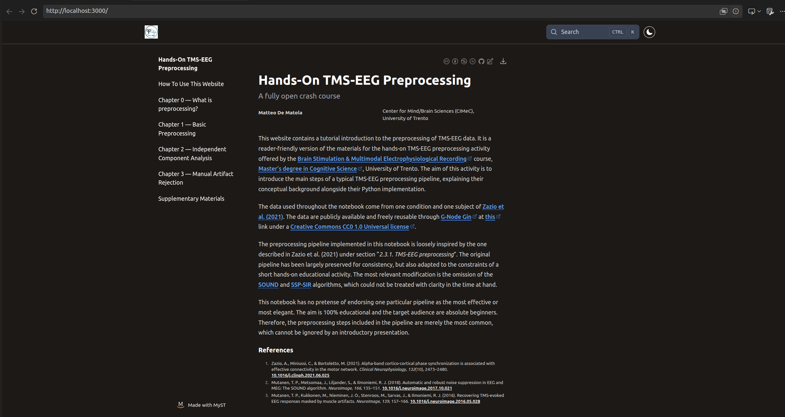

# **Lend An Open Hand: A Fully Open Crash Course on TMS-EEG Preprocessing**
This repository contains the raw files for the open book titled _Lend An Open Hand: A Fully Open Crash Course on TMS-EEG Preprocessing_.

Like the title says, the book is an introductory educational resource on the art and science of TMS-EEG signal preprocessing. Being _introductory_ and _educational_, the material has no pretense of being exhaustive or of reaching the best possible precision. Its target audience are complete beginners &mdash; for example, undergraduate students &mdash; who need the understand what TMS-EEG data look like, what challenges they pose, and how they can start tackling them. For this reason, readers who seek detailed treatment of advanced preprocessing methods should look elsewhere. The book contains a chapter (Supplementary Materials) that provides many pointers to further, more advanced learning resources.

## Access status
At present (September 2026) the book is private because the author is using its contents for teaching, and publishing them would reveal exercise solutions to the students. The book will be published after the end of the teaching activity (December 2026 at the latest) under a CC-BY-NC-ND license. In the meantime, its contents can be accessed exclusively by the author ([Matteo De Matola](https://github.com/matteo-d-m)) and the reviewers of his doctoral thesis, [Dr. Giulia Cisotto](https://github.com/CisottoGiulia) and [Dr. Matteo Mancini](https://github.com/matteomancini). 

## Development status
The book is a work in progress, and it will continue to be after its publication. It is meant to be a living document that improves continuously based on student feedback and the availability of new datasets or ideas. 

## How to build the book
The book is composed by a set of mutually independent Markdown and Jupyter Notebook files. These can be rendered into a textbook using Jupyter Book. To this end, you have to:

1. Install Jupyter Book as described on the official website (https://jupyterbook.org/)
2. Download the contents of this repository or clone it to your machine
3. Navigate to the directory where you downloaded or cloned the repository 
4. Run the following command: `jupyter book start`
    - This should build the book and make it available at `http://localhost:3000`
    - If it fails, run `jupyter book init && jupyter book start`
        - If it fails again, contact the author for help: :mail: matteo [dot] dematola [at] unitn [dot] it

## What the book should look like
If built correctly, the book should look like the following: 

